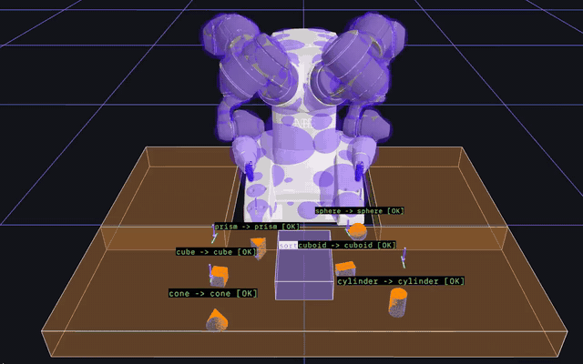

# ABB YuMi Sorting

Perception-driven object sorting on an ABB YuMi dual-arm robot: a synthetic depth
camera + shape classifier identifies six primitive shapes on a table, curobo plans
collision-aware pick-and-place motions (including cross-arm handoffs when an
object's bin is on the opposite side from where it landed), and a PyBullet replay
validates the plan under real gravity/contact/friction physics.

<p align="center">
  <a href="yumi_sorting.mp4">
    
  </a>
</p>

<p align="center">
  <em>Curobo-planned motion in Foxglove, with the robot's collision spheres in purple.
  Labels show <code>true shape -> classified shape</code>; orange points are what the camera
  captured; magenta arrows and cyan lines are the generated grasps. Objects stay put
  because this view is kinematic-only: real contact is checked in PyBullet.
  <a href="yumi_sorting.mp4">Watch the full-quality video</a>.</em>
</p>

## How it works

1. **Scene:** `publish_perception_scene.py` scatters a fresh random layout of 18 objects (three of each shape: sphere, cylinder, cone, cube, cuboid, prism).
2. **Perception:** one simulated overhead depth capture (RealSense D457 specs) is segmented with connected components, then each object's point cloud is classified from what a single view can see: its silhouette and how its height falls off from the top.
3. **Grasping:** `grasp_generator.py` computes an analytic parallel-jaw grasp for each classified shape.
4. **Planning:** curobo plans each pick and delivery. Each arm reaches only the three bins on its own side, so a cross-side object is set down at a shared handoff point and picked up by the other arm, one arm moving at a time.
5. **Validation:** PyBullet replays the planned trajectories with objects as real rigid bodies, so a grasp only counts if it actually holds.

## Layout

- `yumi_description/` — robot URDF/meshes, ROS2 scripts, curobo scene config
  - `scripts/publish_home_pose.py`, `publish_table_marker.py`, `publish_perception_scene.py` — ROS2/Foxglove side (system Python)
  - `scripts/curobo_live.py`, `curobo_one.py`, `curobo_all.py`, `curobo_shared.py` — motion planning (curobo venv)
  - `scene/table.yml`, `scene/bins.yml` — static obstacle geometry
- `perception/` — synthetic camera, point-cloud extraction, shape classification, grasp generation
- `physics/` — PyBullet physics validation (`physics_one.py`, `physics_all.py`, its own venv)
- `ros2_ws/` — ROS2 services exposing curobo FK/IK
- `test/` — real-robot bring-up: RAPID modules, module upload over RWS, and a pick-and-place driver (`run_real_pickplace.py`)
- `demo_one.sh`, `demo_live.sh` — one-command end-to-end demos

## Running it

```bash
./demo_one.sh --only-correct   # fast: plan one grasp, validate it in PyBullet (GUI by default)
./demo_live.sh                 # watch the whole sort happen live in Foxglove
```

Both scripts bring up ROS2 (`robot_state_publisher`, `foxglove_bridge`), the table,
and a fresh randomized scene on their own.

To validate the whole sort under physics rather than a single grasp, run
`yumi_description/scripts/curobo_all.py` (curobo venv), then `physics/physics_all.py`
(physics venv).

> **Note:** several scripts, including `yumi_bringup.launch.py`, hardcode the repo
> path as `/home/abdul/Documents/yumi`. Clone to that path or update `REPO_ROOT`
> in those files first (`grep -rn /home/abdul .` lists them).

## Dependencies

- ROS2 Humble, with `foxglove_bridge` and Foxglove Studio
- [curobo](https://github.com/NVlabs/curobo) — vendored separately at `curobo/` (not tracked in this repo; clone it there and set up its own venv per its docs). Planning runs on a CUDA GPU.
- PyBullet — see `physics/` for its own venv setup
